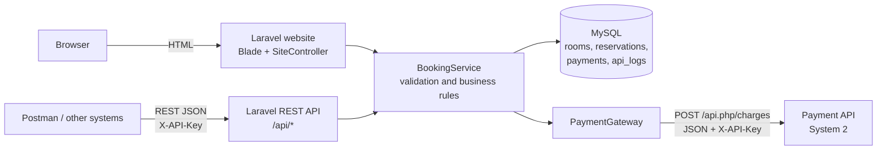
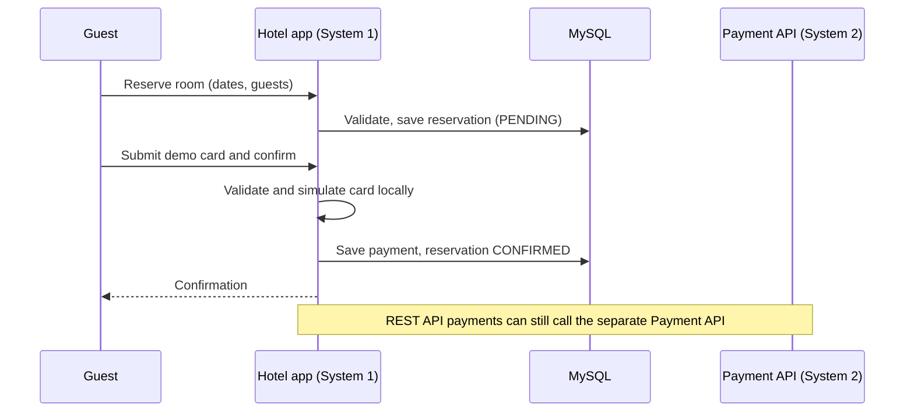

# Casa Grande Hotel

A hotel reservation system built with **Laravel 12** that is integrated with a separate **demo Payment API** over REST and JSON.
Guests search rooms, reserve, and simulate payment by **card, GCash or Maya**. The same logic is also exposed as a **REST API**.

> CIT 305 – Systems Integration and Architecture 1 · Final project: *Hotel Reservation System + Payment API*

## Features
- Modern dark and gold website: hero with availability search, room cards, live price summary, split payment page, confirmation ticket, mobile friendly
- Availability search by dates and guests (rooms already booked for those dates, or too small, are marked unavailable)
- Guest registration and login required to book a room and manage personal reservations
- Booking validation: dates, capacity, overlapping reservations, amount check
- Demo payments: Visa, Mastercard, JCB and Amex test cards with suggested Philippine banks or a custom issuer name, plus simulated GCash/Maya
- REST API protected by an `X-API-Key` header, rate limited
- **API log** page: payment requests store only a masked card number/CVV and never the API key
- Demo only: card entries are format-checked; the simulator does not contact an issuer or charge money. Never enter real card details.
- Docker Compose deployment (app + Payment API + MySQL), health check, CI workflow, tests

## Architecture



**System 1** is the Hotel Reservation System (this Laravel app). **System 2** is the local demo Payment API in `payment-api/`.
The integration point is `app/Services/PaymentGateway.php`.



## Run locally

Requirements: PHP 8.2+, Composer, MySQL.

```bash
composer install
cp .env.example .env            # Windows PowerShell: Copy-Item .env.example .env
php artisan key:generate
# create an empty MySQL database named casa_grande, then:
php artisan migrate --seed
php -S 127.0.0.1:8003 -t payment-api     # terminal 1: Payment API
php artisan serve                         # terminal 2: website  -> http://127.0.0.1:8000
```
Wait until `http://127.0.0.1:8003/api.php/health` returns `{"status":"ok"}` before submitting a payment.

**Windows + XAMPP:** start MySQL in the XAMPP Control Panel, then in the project folder run `.\start-local.bat`.
It installs dependencies, creates the database, builds the tables, starts both servers and opens the browser.
Create an account or log in before reserving; the Reservations page lists only bookings made by your account.
To grant administrator access, first create a regular account, then run `php artisan admin:promote your-admin-email@example.com`. Sign in with that account and open `/admin`; the admin area is not linked in guest navigation. Administrators can manage rooms and set them Available or Fully booked, oversee reservations, and manage account roles. Admins can cancel a reservation or permanently delete it along with its payment records; deletion does not issue a refund. Deleting a user preserves reservation and payment history.

### Booking confirmation email (SMTP)

After payment succeeds, the guest email on the reservation receives a confirmation with the room, reservation code, stay dates, guest and night counts, payment method, payment date, and total. Set the SMTP values in your local `.env` (do not share or commit your SMTP password):

```dotenv
MAIL_MAILER=smtp
MAIL_SCHEME=tls
MAIL_HOST=smtp.gmail.com
MAIL_PORT=587
MAIL_USERNAME=your-email@gmail.com
MAIL_PASSWORD=your-gmail-app-password
MAIL_FROM_ADDRESS=your-email@gmail.com
MAIL_FROM_NAME="Casa Grande Hotel"
```

Use your SMTP provider's host and credentials if you do not use Gmail. Gmail requires an App Password, not your regular account password. After editing `.env`, run `php artisan config:clear` and restart the Laravel server. If SMTP delivery fails, the booking remains confirmed and the mail error is written to the Laravel log.

## Deploy with Docker

```bash
cp .env.docker.example .env.docker
# edit .env.docker: set APP_KEY, DB_PASSWORD, HOTEL_API_KEY, PAYMENT_API_KEY, and SMTP settings
echo "base64:$(openssl rand -base64 32)"      # use this value for APP_KEY
docker compose --env-file .env.docker up -d --build
```

The site is then at `http://localhost:8000` (set `APP_URL` and put it behind HTTPS in production).
On start the container waits for MySQL, runs migrations, seeds the demo rooms, caches config/routes/views and serves with Apache.
The Payment API is **not** published; only the app container can reach it.

Deploying elsewhere (Render, Railway, a VPS): build the `Dockerfile`, point it at a MySQL database with the `DB_*` variables below, set `APP_KEY`, `HOTEL_API_KEY`, `PAYMENT_API_KEY`, and run the Payment API (`payment-api/Dockerfile`) as a second private service; set `PAYMENT_API_URL` to its address.

**Before going live:** commit `composer.lock` (run `composer install` once and commit the file), replace every demo key and password, use HTTPS, and keep `APP_DEBUG=false`.

## Environment variables

| Variable | Purpose | Default |
|---|---|---|
| `APP_KEY` | Laravel encryption key (required) | generated by `php artisan key:generate` |
| `APP_ENV`, `APP_DEBUG`, `APP_URL` | Environment | `local`, `true`, `http://localhost` |
| `DB_CONNECTION`, `DB_HOST`, `DB_PORT`, `DB_DATABASE`, `DB_USERNAME`, `DB_PASSWORD` | MySQL | `mysql`, `127.0.0.1`, `3306`, `casa_grande`, `root`, empty |
| `HOTEL_API_KEY` | Key clients send as `X-API-Key` to `/api/*` | `demo-key-123` |
| `PAYMENT_API_URL` | Payment API endpoint | `http://127.0.0.1:8003/api.php/charges` |
| `PAYMENT_API_KEY` | Key the hotel app sends to the Payment API (and the Payment API expects) | `pay-key-456` |
| `MAIL_MAILER`, `MAIL_SCHEME`, `MAIL_HOST`, `MAIL_PORT` | SMTP transport settings | `smtp`, `tls`, provider host, `587` |
| `MAIL_USERNAME`, `MAIL_PASSWORD` | SMTP credentials | Set privately in `.env`; for Gmail, use an App Password |
| `MAIL_FROM_ADDRESS`, `MAIL_FROM_NAME` | Sender displayed on booking emails | Your verified sender address, `Casa Grande Hotel` |

## REST API

Base URL `http://127.0.0.1:8000/api`. Headers: `X-API-Key`, `Accept: application/json`, `Content-Type: application/json`.

| Method | Path | Body | Success |
|---|---|---|---|
| GET | `/rooms` | | 200 list of rooms |
| GET | `/reservations` | | 200 list |
| POST | `/reservations` | `room_id, guest_name, guest_email, check_in, check_out, guests` | 201 reservation (`PENDING`) |
| GET | `/reservations/{id}` | | 200 reservation |
| DELETE | `/reservations/{id}` | | 200 `CANCELLED` |
| POST | `/payments` | `reservation_id, amount, method` + card: `bank, card_holder, card_number, expiry (MM/YY), cvv` or wallet: `mobile_number` | 201 `PAID`, reservation `CONFIRMED` |

Errors are JSON `{"error": "..."}` with status 400 (invalid), 401 (key), 402 (payment declined), 404, 409 (conflict), 422 (amount mismatch), 502 (payment service unavailable).

Example payment:
```json
{ "reservation_id": "RSV-1001", "amount": 5000, "method": "card", "bank": "BDO Unibank",
  "card_holder": "Juan Dela Cruz", "card_number": "4242424242424242", "expiry": "12/30", "cvv": "123" }
```

**Payment API (System 2)** `POST /api.php/charges` with header `X-API-Key`. Test data:

| Input | Result |
|---|---|
| Card `4242 4242 4242 4242` (Visa), `5555 5555 5555 4444` (Mastercard), `3530 1113 3330 0000` (JCB) | simulated approval for any issuer name |
| Card `4000 0000 0000 0002` | declined (402) |
| GCash or Maya `09171234567` (or `+63 917 123 4567`) | approved |
| GCash or Maya number ending in `0000` | declined, insufficient balance (402) |

## Integration test cases

| ID | Scenario | Expected |
|---|---|---|
| TC-01 | Valid reservation | 201, reservation id returned |
| TC-02 | Missing required field | 400 and error message |
| TC-03 | Guests above room capacity | 400 |
| TC-04 | Valid card payment | 201 `PAID`, reservation `CONFIRMED` |
| TC-05 | Declined card | 402 `FAILED`, reservation stays `PENDING` |
| TC-06 | Unknown reservation id | 404 |
| TC-07 | Wrong or missing API key | 401 |
| TC-08 | Same room and dates reserved twice | 409 |
| TC-09 | Payment API stopped | 502 |

Import `docs/casa-grande.postman_collection.json` into Postman to run them (set the `apiKey` variable). Automated version:

```bash
php artisan test        # tests/Feature/HotelFlowTest.php (uses an in-memory SQLite database, Payment API is faked)
```

## Project structure

```
app/Http/Controllers/SiteController.php      website pages
app/Http/Controllers/Api/*                   REST API
app/Http/Middleware/ApiKey.php               X-API-Key check
app/Services/BookingService.php              validation and business rules
app/Services/PaymentGateway.php              System 1 -> System 2 integration + masked logging
app/Models/                                  Room, Reservation, Payment, ApiLog
database/migrations, database/seeders        tables and demo rooms
resources/views, public/{css,js,img}         pages, styles, scripts, photos
payment-api/                                 System 2: Payment API (plain PHP)
docker/, Dockerfile, docker-compose.yml      deployment
docs/                                        Postman collection
tests/Feature/HotelFlowTest.php              integration tests
```

## Notes
- Website card payments are simulated locally by the hotel app, so the Payment API does not need to be running to confirm a card booking. REST API payments still call the separate Payment API. No real bank or wallet is contacted and no real money is charged; use only the sample test card numbers shown on the payment page.
- GCash and Maya QR payments are also simulated locally; no real wallet account is connected.
- Booking confirmation emails are sent to the reservation guest email after successful card, wallet, or REST API payments.
- Fonts load from Google Fonts when online and fall back to Georgia/Arial offline.
